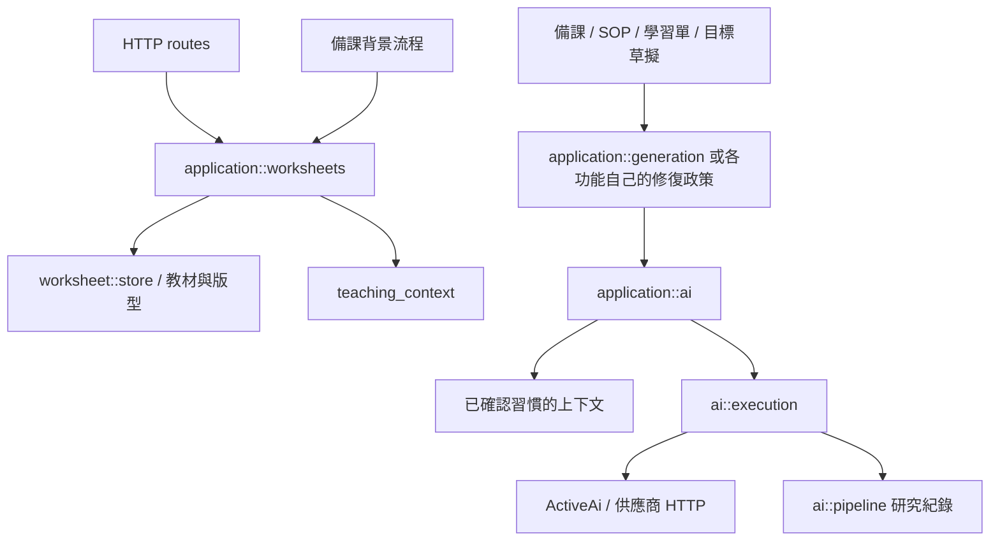

# Manna 程式模組與依賴邊界

本文件描述目前的程式分工；HTTP 合約仍以 [API.md](API.md) 為準。
部署架構、資料表與研究規格見 [BLUEPRINT.md](BLUEPRINT.md)。

## 入口與應用服務

HTTP handlers 負責登入身分、解析請求與產生回應；背景工作也可直接呼叫相同的應用操作。
應用服務與內容規則不依賴 `routes`，避免為了重用建立流程而引用 HTTP 功能模組。

### 學習單建立與產生輸入

`application::worksheets::WorksheetService` 接收 `PgPool`，提供：

- `create`：教師權限、教材／版型選取、SOP 帶入、設定正規化、第一版內容及研究事件。
- `prepare_generation`：已選學習單的最新內容、課例連結與可見班級情境。

HTTP 建立／產生／重做／逐區修改，以及備課對話產生學習單，都使用這一個服務。
命令型別 `CreateWorksheet`、`CreateOverrides` 與 `PastedMaterial` 位於相同模組；
它們沒有 HTTP extractor 或 response 的相依。`CreateWorksheet` 保留原本的 serde
輸入形狀，讓 HTTP 與背景流程共用同一份正規化規則。
「只選要用的段落」也在這裡：`POST /api/worksheets` 的 `paragraph_ids` 與備課對話的
`options.paragraph_ids` 都經 `CreateWorksheet.paragraph_ids` 走同一個 `chosen_material`。

目前的 `WorksheetState` 是 HTTP 查詢視圖，留在 `routes::worksheets`。其他編輯、匯出、
SOP 同步 handler 尚未全部搬入應用服務；新增可重用的業務操作應放在應用服務，
避免擴大這些 handler 的跨功能相依。

## AI 呼叫的三個責任

| 模組 | 責任 |
|---|---|
| `application::ai` | 依功能／研究開關帶入已確認習慣，取得該工作的 `ActiveAi`，交給 traced attempt |
| `ai::execution` | 一次模型呼叫、時間量測、研究互動紀錄、供應商失敗分類；不讀任何備課／學習單功能模組 |
| `application::generation` | 共用的結構化輸出流程：提示詞組裝、遮罩、檢查後修復一次、保留可用結果及進度回報 |

備課內容、SIOP 自我檢核及學習單逐區修改共用 `application::generation`。
呼叫端提供內容檢查，以及「哪一些上下文變數必須依提示詞版本帶入」的政策；
共用 runner 不引用 `objectives`、`prep` 或 `sop` 的功能程式。

一般學習單與 SOP 的既有合併／修復政策仍各自保留，使用相同的 traced attempt；
這些不同的結果採用規則不強制合併成一個泛用 workflow。
`ai::pipeline` 中的既有通用流程與研究紀錄型別也繼續使用。

這次模組整理保留原有模型設定 pin、提示詞、schema、修復溫度、輸出採用規則與 snapshot
欄位（包含歷史上的 `prep` trace 欄位名稱）。共用工具的檔案位置不是研究版本，
因此沒有新增提示詞版本或修改資料庫 schema。

## 跨功能的支援模組

- `teaching_context`：教師所擁有的單元／課例／班級查詢，以及可見班級特性的優先順序。
- `audit`：研究使用事件與 scaffold 參照查詢。
- `prompts::latest_required`：載入有效提示詞，缺少配置時回報既有錯誤。
- `text`：文字截取與空白欄位的提示詞表示。
- `serde_support`：區分 PATCH 欄位未送出、明確 null 與值。

這些工具不從 HTTP router 匯出，內容模組也不需要為了共用它們而依賴 routes。

## 驗證與後續範圍

`api/tests/architecture.rs` 檢查應用／內容模組沒有直接引用 `crate::routes`，以及 provider
execution 沒有反向引用應用與功能模組。這是輕量的原始碼依賴檢查，不取代 Rust 的型別
檢查與功能整合測試。
`worksheet_application.rs` 比較直接呼叫與 HTTP 建立的結果、產生情境，並檢查直接建立
仍然維持教師所有權驗證。既有 API、備課、SOP、版型、修復、研究記憶與模型切換測試
保護行為相容性。

背景工作的 lease／重啟恢復統一、動態設定的可用性重算，以及 Graphiti client／worker／
forwarder 拆分是獨立後續工作。本輪沒有變更其生命週期或部署設定。
