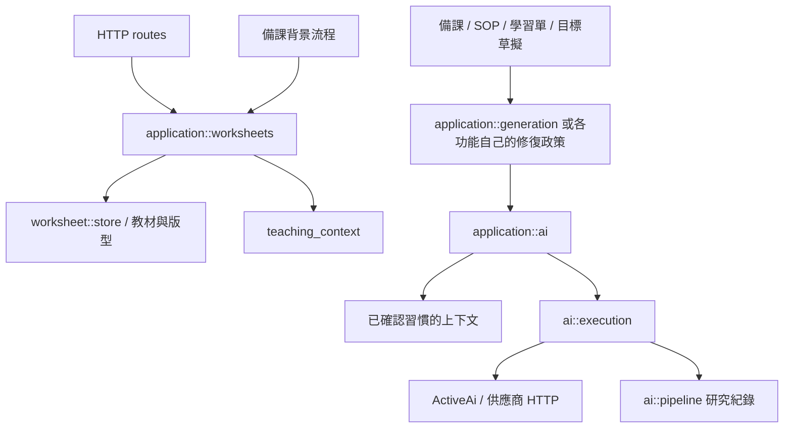

# Manna 程式模組與依賴邊界

本文件描述目前的程式分工；HTTP 合約仍以 [API.md](API.md) 為準。
部署架構、資料表與研究規格見 [BLUEPRINT.md](BLUEPRINT.md)。

## 入口與應用服務

HTTP handlers 負責登入身分、解析請求與產生回應；背景工作也可直接呼叫相同的應用操作。
應用服務與內容規則不依賴 `routes`，避免為了重用建立流程而引用 HTTP 功能模組。

### 學習單建立與產生輸入

`application::worksheets::WorksheetService` 接收 `PgPool`，提供：

- `create`：教師權限、教材／版型選取、SOP 帶入、設定正規化、第一版內容及研究事件。
- `prepare_generation`：依 id 驗證教師所有權，再讀取最新內容、課例連結與可見班級情境。

HTTP 建立／產生／重做／逐區修改，以及備課對話產生學習單，都使用這一個服務。
命令型別 `CreateWorksheet`、`CreateOverrides` 與 `PastedMaterial` 位於相同模組；
它們沒有 HTTP extractor 或 response 的相依。`CreateWorksheet` 保留原本的 serde
輸入形狀，讓 HTTP 與背景流程共用同一份正規化規則。
「只選要用的段落」也在這裡：`POST /api/worksheets` 的 `paragraph_ids` 與備課對話的
`options.paragraph_ids` 都經 `CreateWorksheet.paragraph_ids` 走同一個 `chosen_material`。

`application::worksheets::editing` 提供儲存、換教材、段落選取、區塊復原與刪除；
`application::worksheets::synchronization` 提供同步預覽／確認、連結課例與另存新課例。
命令接收教師 id 與一般 Rust 型別，內部驗證所有權；同步操作只需要 `PgPool`，編輯操作
需要工作狀態與縮圖處理，因此接收 `AppState`。HTTP handler 只解開請求並組裝回應。

同步、連結與另存課例各由應用操作持有一筆 transaction。跨文件寫入以 worksheet → lesson
順序鎖定，於鎖內重讀所有權及預覽版本；課例、學習單、教材連結與研究事件一起提交。
預覽使用唯讀 repeatable-read 快照，新版確認同時帶入 worksheet 版本、更新時間與 lesson id，避免確認
期間課例連結變動。store 保留原本獨立操作，並提供 `*_in_tx` 讓應用操作共用同一連線；
課綱查詢也使用該連線，不在持有鎖時另外向 pool 要連線。

`WorksheetState` 仍是 HTTP 查詢視圖。檔案串流、匯出格式、multipart 上傳、圖片回應快取
與 HTTP status／header 保留在 transport 層，內容規則由既有 worksheet 模組負責。

## AI 呼叫的三個責任

| 模組 | 責任 |
|---|---|
| `application::ai` | 依功能／研究開關帶入已確認習慣，取得該工作的 `ActiveAi`，交給 traced attempt |
| `ai::execution` | 一次模型呼叫、時間量測、研究互動紀錄、供應商失敗分類；不讀任何備課／學習單功能模組 |
| `application::generation` | 共用的結構化輸出流程：提示詞組裝、遮罩、檢查後修復一次、保留可用結果及進度回報 |

備課內容、SIOP 自我檢核及學習單逐區修改共用 `application::generation`。
呼叫端提供內容檢查，以及「哪一些上下文變數必須依提示詞版本帶入」的政策；
共用 runner 不引用 `objectives`、`prep` 或 `sop` 的功能程式。

一般學習單與 SOP 的既有合併／修復政策仍各自保留，使用相同的 traced attempt；
這些不同的結果採用規則不強制合併成一個泛用 workflow。
`ai::pipeline` 中的既有通用流程與研究紀錄型別也繼續使用。

這次模組整理保留原有模型設定 pin、提示詞、schema、修復溫度、輸出採用規則與 snapshot
欄位（包含歷史上的 `prep` trace 欄位名稱）。共用工具的檔案位置不是研究版本，
因此沒有新增提示詞版本或修改資料庫 schema。

## 逐步設計的 AI 步驟

`sop::ai` 保留第 2、3 步與背景工作的共同部分（`lesson_sop_jobs`、slot、重啟與加入規則）；第 3 步的英文修改，以及第 4–7 步在 `sop::stages`。它們全部走 `application::generation::call_in`（檢查後修復一次、保留可用結果；`call_in` 比 `call` 多帶 unit／lesson 供研究紀錄），第 5–7 步直接使用 `worksheet::checks` 的檢查與 `worksheet::schemas`，不複製規則。`sop::stages` 不引用 `routes`。

### 共用生成入口的模型範圍

`application::generation::call_in` 為整輪生成建立模型 pin，涵蓋第一次呼叫與修復重試；
若已有背景工作的 pin，沿用外層設定。同步的「幫我修英文」與背景生成具有相同保證，
呼叫端不用自行補上 pin。

### 依步驟與規則拆分

`sop::stages` 的 goals、tasks、warmup、exit、english 各自維護對應 schema、檢查與生成流程，
共用 runner／上下文放在入口；原有公開路徑透過 re-export 保留。`worksheet::revise::rules`
負責 schema 與純合併，`persistence` 負責 proposal、交易、採用／放棄及歷程。
前端 `StagesManual` 保留相容入口，實作分為 StageIntegrate、StageTasks、StageWarmup、StageExit。

SOP 工作輪詢以 job id 限制同時一筆請求；回應必須仍對應目前的 running 工作才可更新。
研究 show 事件只在有效 running → done/shown 轉換後送出，與 React state updater 的執行次數
無關。新增工作導致 effect 重建時，既有進行中的請求仍受相同限制。

## 跨功能的支援模組

- `teaching_context`：教師所擁有的單元／課例／班級查詢，以及可見班級特性的優先順序。
- `audit`：研究使用事件與 scaffold 參照查詢。
- `prompts::latest_required`：載入有效提示詞，缺少配置時回報既有錯誤。
- `text`：文字截取與空白欄位的提示詞表示。
- `serde_support`：區分 PATCH 欄位未送出、明確 null 與值。

這些工具不從 HTTP router 匯出，內容模組也不需要為了共用它們而依賴 routes。

## 背景工作與設定切換

`jobs::run` 為備課、SOP、學習單生成／修改、版型、SIOP 檢核、OCR、產圖及 Graphiti
同步隔離工作 task，把 panic 與執行錯誤交回擁有結果的呼叫端。呼叫端仍負責關閉資料列、
更新進度與保留原本的教師訊息；執行器不重送模型請求，也不替所有功能發明同一套資料表。
模型 pin 必須在排入工作時取得，再隨 future 進入隔離的 task；`AiClient::enabled` 和
`active` 都讀取該 pin，因此全域設定變更不會提前終止已啟動的工作。

| 工作 | 既有持久化及中斷處理政策 |
|---|---|
| 備課／SOP／學習單／修改／版型／檢核 | 結果及進度存於各自資料表；錯誤／panic 由呼叫端結束，程序中斷後由既有 stale 判斷回報教師重試 |
| OCR／產圖 | 啟動時接手未完成工作；每次寫入檢查 run 標記，舊工作不能覆蓋接手後的結果 |
| Graphiti | Postgres outbox、到期 lease、重試退避、獨立 attempt group 與 revision 比對後發布；worker 的單次同步失敗／panic 後仍繼續輪詢 |

這些恢復政策適用不同副作用：本次整合共同執行與錯誤處理，保留各功能既有的持久化與
重啟政策。多 API instance 協調、統一 durable queue 或自動重播文字生成，不是目前的能力。

## 教師長期記憶的模組分工

| 模組 | 責任 |
|---|---|
| `memory`（`mod.rs`） | 封閉類型與 canonical 句子、`Memory`、帶入習慣的上下文（`habit_context`、`augment`）與研究 snapshot |
| `memory::extraction` | `teacher_memory_extract` 的一次呼叫、回覆驗證（封閉詞彙、自由句子、scope、替換 id）與測試用 fixture |
| `memory::statement`、`memory::scope` | 自由習慣句子的個資／格式檢查；適用範圍對應到 `HABIT_STEPS` |
| `memory::selection` | 帶入哪些習慣：scope 篩選、embedding 排序（pgvector）、最近確認備援，並產生 `selection` 紀錄 |
| `memory::candidates` | 候選（出處、顯示、確認、不用、修改、過期）與其研究事件；確認的交易（上限、取代、歷程、索引工作） |
| `memory::detect` | 前置篩選與背景偵測；只提議候選，從不儲存習慣 |
| `memory::routes` | HTTP 轉接 |

`memory::detect` 由備課對話、逐區修改與學習單建立的 route 在請求完成後呼叫；它不引用 `routes`，
與其他背景工作一樣在排入時固定模型（備課對話沿用該輪的 pin）。

## Graphiti 邊界與可用性

`memory::graph` 是入口，內部分工如下：

| 模組 | 責任 |
|---|---|
| `config` | 驗證 URL、服務 token、代理 URL 的部署接線，不依啟動時文字模型刪掉設定 |
| `client` | sidecar 路徑、驗證、timeout、健康與版本相容檢查；沒有 SQL 或工作發布邏輯 |
| `runtime` | 健康快取、工作模型 pin 及目前 provider 能力判斷 |
| `worker` | 領取 lease；完整重建（正本快照、新 group、條件發布）或增量更新（已發布 group 的 `memory_index_ops`）、重試及垃圾群組回收 |
| `observation` | 查詢已發布索引，與教師有效習慣交集，異常時要求重建 |
| `forwarder` | 私有 HTTP 驗證、欄位白名單、呼叫配額、供應商轉發與研究追蹤 |
| `status` | 一般 Rust 型別的佇列／能力查詢；PI 驗證與 JSON 回應由 `memory::routes` 負責 |

部署接線完整時，內部 listener 與 worker 會啟動，正本修改持續排入 outbox。
每次同步會固定目前模型並重新判斷 provider 能力；沒有可用模型／embedding 時不領取
工作、不增加重試次數，生成回到 Postgres 習慣。切換至可用模型後下一次輪詢自動恢復。
管理頁分別顯示「有接線」、「provider 可用」與「sidecar 相容」，保留實際待同步數；
文字模型套用／恢復成功後，由管理頁通知記憶面板重讀狀態，不需要重新整理整頁。

## 驗證

`api/tests/architecture.rs` 檢查應用／內容模組沒有直接引用 `crate::routes`，以及 provider
execution 沒有反向引用應用與功能模組。這是輕量的原始碼依賴檢查，不取代 Rust 的型別
檢查與功能整合測試。
`worksheet_application.rs` 比較直接服務與 HTTP 建立及產生情境，並直接驗證編輯、清除
request、連結與另存課例的所有權；既有 API 測試保護輸入輸出、版本衝突、SOP 同步與復原。
`teacher_memory.rs` 驗證環境預設關閉時載入管理員覆蓋、工作中途切換模型、停用時保留
待同步工作，以及重新啟用後發布／搜尋的完整路徑。`jobs` 測試確保錯誤／panic 回到呼叫端，
並驗證隔離 task 內的模型啟用判斷遵守 pin。

跨文件儲存的回滾與並行版本檢查由 `worksheet_transactions.rs` 驗證，包括注入學習單寫入／
研究事件失敗、相同預覽同時確認、鎖等待期間的 SOP 修改，以及只有一條 pool 連線的成功路徑。
`generation_model_pin.rs` 使用本機供應商 fixture，驗證修復重試期間切換模型仍沿用原模型，
下一次請求才使用新設定。前端 `sopPolling.test.tsx` 驗證慢回應與 effect 重建的請求／事件去重。
