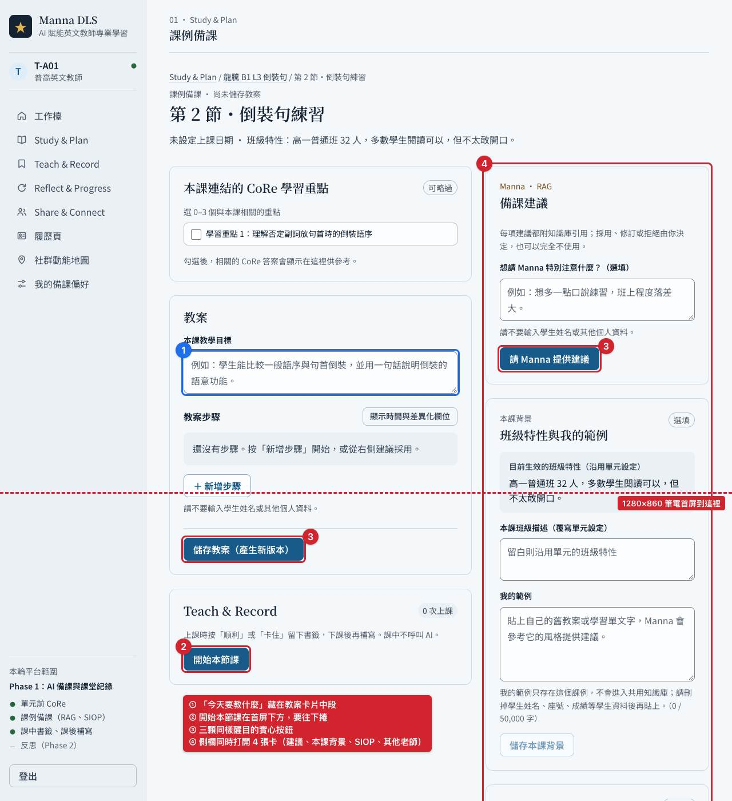
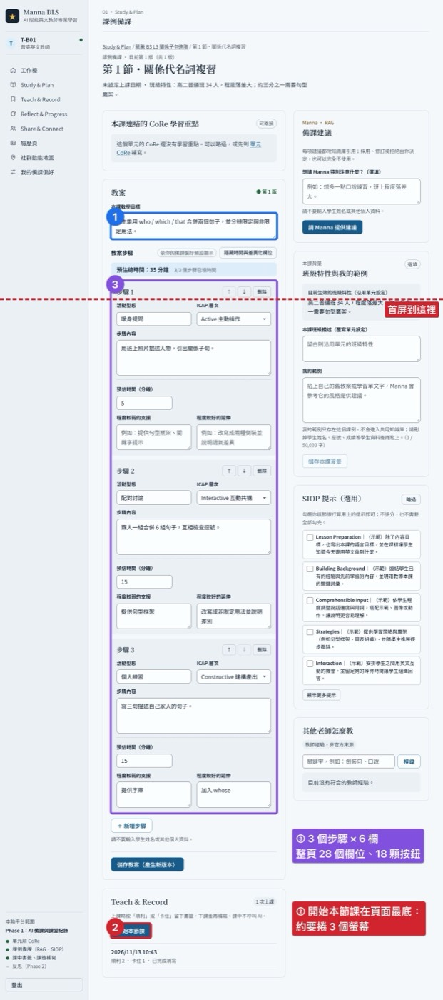
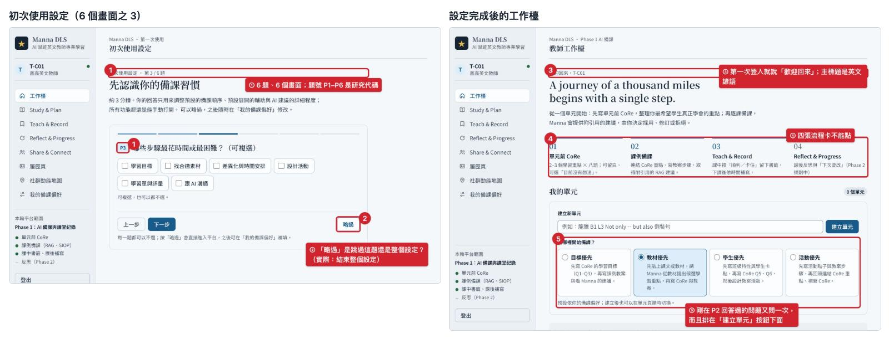
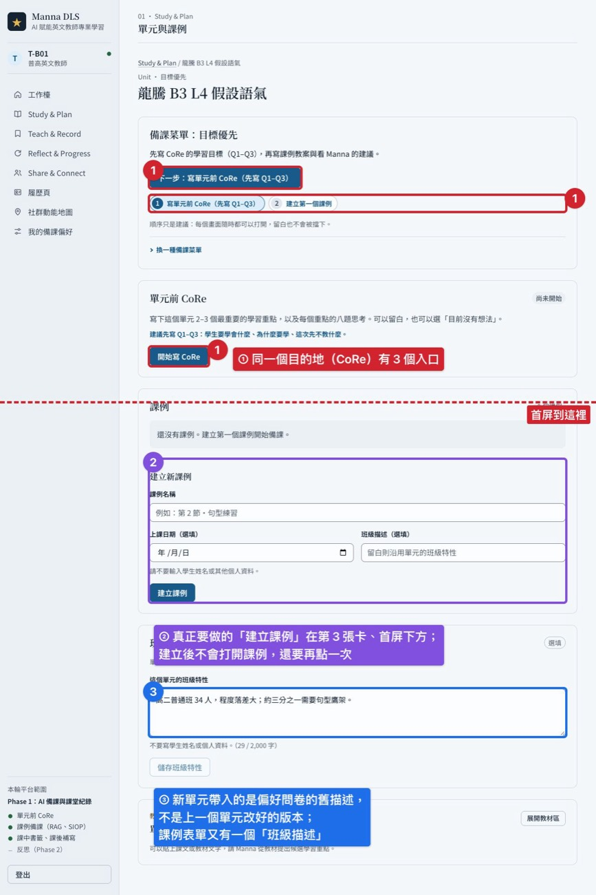
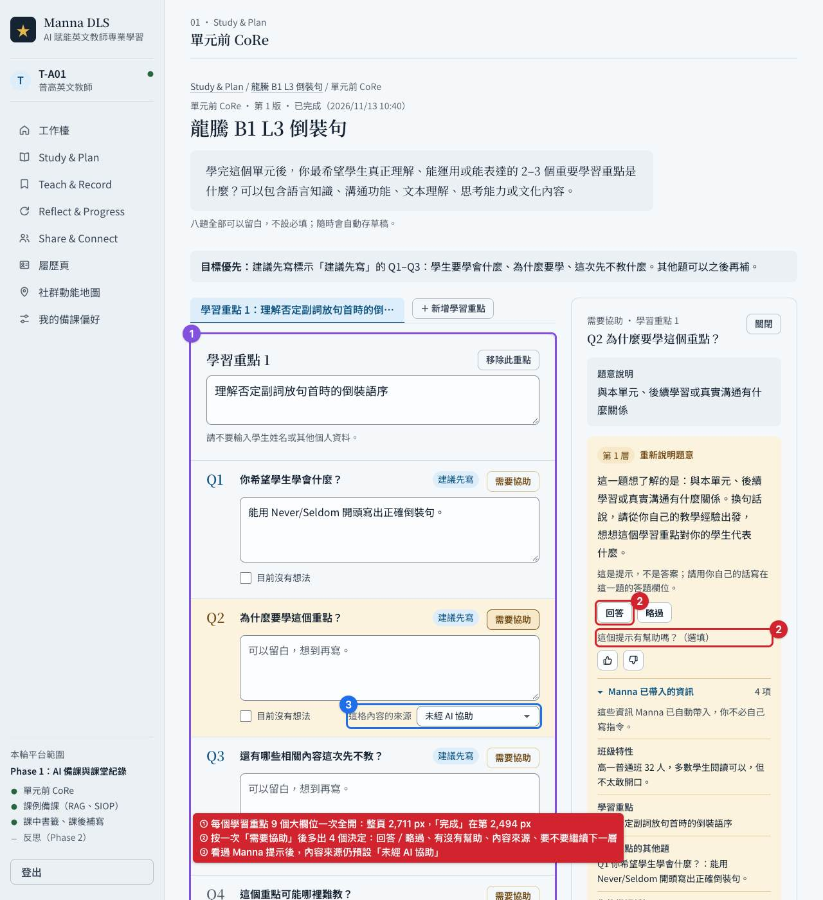
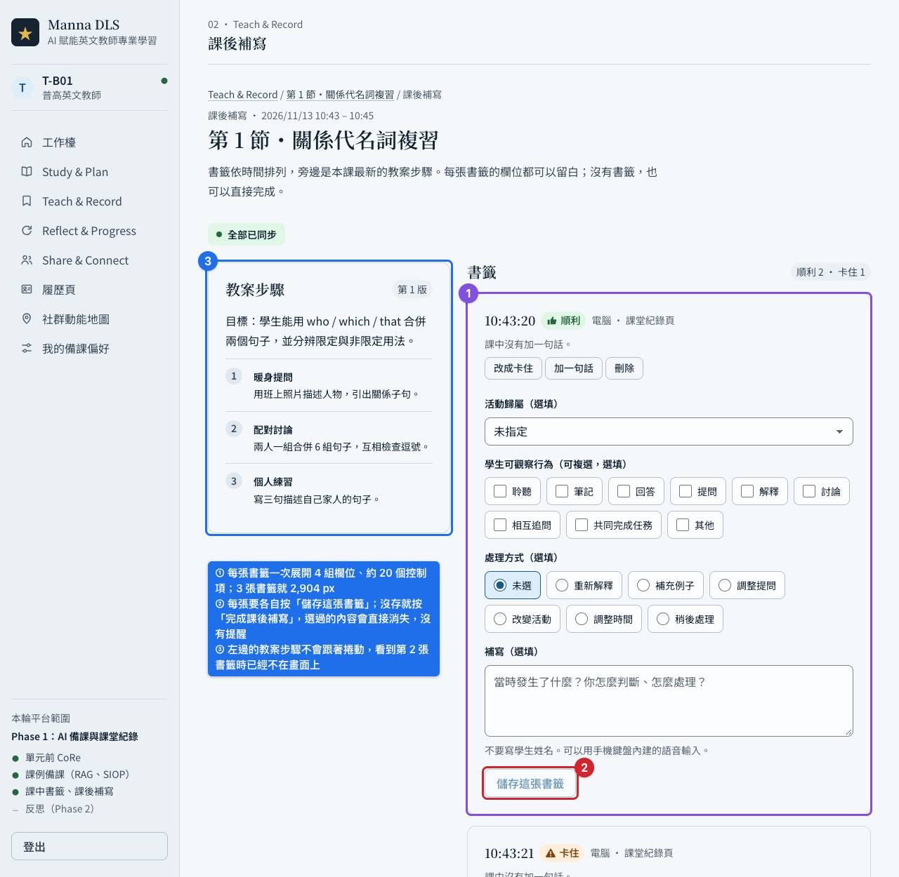
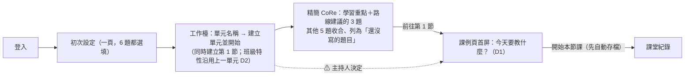
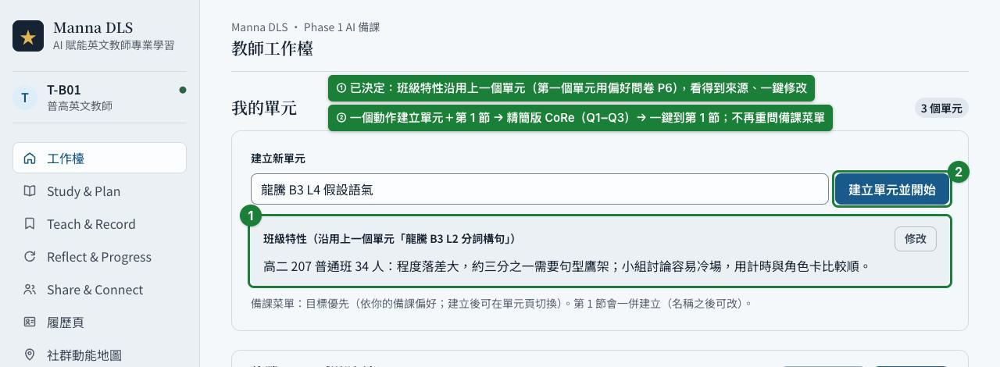
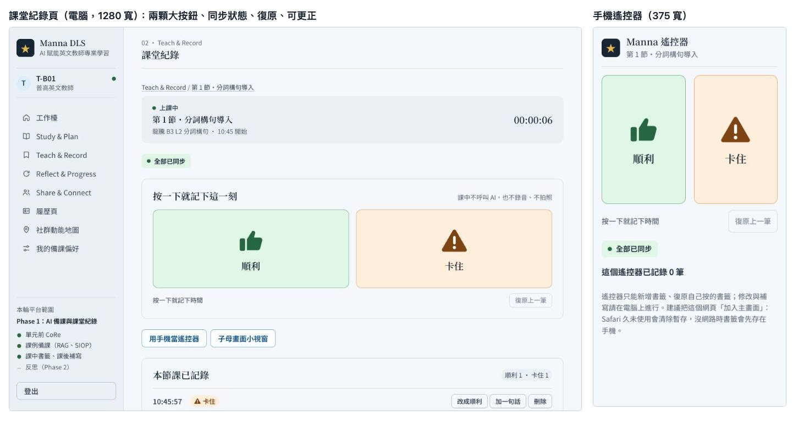

# UX 審查與簡化提案：從登入到開始上課

> 審查日期：2026-11-13 · 版本：`main` @ `a87c08c`（two-ink 視覺系統之後）
> 方法：在本機跑一份乾淨資料庫（`AI_PROVIDER=fake`），用三位虛擬教師實際走完流程並計數；1280×860 筆電與 375 寬手機兩種畫面。截圖都在 [`ux-review/`](ux-review/)。
> 依據：[BLUEPRINT](BLUEPRINT.md)、[ONBOARDING](ONBOARDING.md)、[TEACHER_NEEDS](TEACHER_NEEDS.md)、[DESIGN](DESIGN.md)、規格 v1.0（§4.1、§4.2、§4.3、§5.3、§5.4、§6.4）。
> 本文件只提建議，不改程式。標 ⚠ 的項目會影響研究資料，需要主持人決定。

## 一句話結論

目前每一步都「可以留白」，但畫面把所有東西同時攤開：新手從登入到按下「開始本節課」要經過 **12 個畫面、22 次點擊、21 個文字欄位**，而且「開始本節課」在課例頁永遠在首屏下方。另外有兩個**會默默丟資料**的地方（見 F2）。已決定的兩項修改方向正確；再加上「一步建立單元＋第 1 節」與「開始前自動存檔」，新手路徑可降到 **5 個畫面、11 次點擊、8 個文字欄位**，不刪除任何 CoRe 題目。

---

## 1. 現況：三位教師走一遍

| | A：新手（0–2 年、不太會下指令） 首次登入 → 第 1 節開始上課 | B：資深、第二個單元 建立新單元 → 第 1 節開始上課 | C：課中使用 開始 → 電腦＋手機標書籤 → 結束 → 補寫 |
|---|---|---|---|
| 經過的畫面 | **12**（登入、設定精靈 6、工作檯、單元頁、CoRe、單元頁、課例頁） | **5**（工作檯、單元頁、CoRe、單元頁、課例頁） | **4**（課例頁、課堂紀錄、手機遙控、課後補寫） |
| 點擊（不含打字、捲動） | **22** | **10**（只寫目標）／**16**（寫 3 個步驟） | **15**（3 張書籤，每張補寫 1 項） |
| 看到的文字欄位 | **21** | **19**／**37**（含 3 個步驟） | 補寫頁 **67** 個控制項（每張書籤約 21 個） |
| 看到的選項（勾選、單選） | 37 | 約 20 | — |
| 真正必填 | 3（邀請碼、單元名稱、課例名稱） | 2 | 0 |
| 「開始本節課」位置 | 課例頁第 1,132 px（首屏 860 px 以下） | 第 2,664 px（約捲 3 個螢幕）；手機 3,448 px | 同 B |

計數方式：照畫面上的「下一步」提示走、內容寫到最少（A 寫 1 個學習重點＋Q1、一句目標）。A 的 22 次中有 12 次花在設定精靈、6 次花在單元頁與 CoRe 之間來回、2 次是「建立課例後還要再點進去」「先存檔才不會丟目標」。

---

## 2. 前五大摩擦點（附證據）

### F1. 課例頁一次攤開全部，「開始本節課」被埋在下面

- 首屏是「CoRe 連結」與「教案」；「開始本節課」在第 3 張卡，筆電要往下捲（A：1,132 px；B 有 3 個步驟時 2,664 px）。
- 同一頁有 3 顆一樣醒目的實心按鈕（儲存教案、開始本節課、請 Manna 提供建議）、6 張卡、側欄 4 張同時打開。違反 DESIGN.md「每個區域一顆實心按鈕」的精神：區域分開了，但教師分不出哪一顆是今天要按的。
- 偏好選了「差異化與時間安排」的教師，每個步驟 6 欄全開；3 個步驟就 28 個欄位。

### F2. 兩個地方會默默丟掉教師寫的東西

| 位置 | 重現步驟 | 結果 |
|---|---|---|
| 課例頁 | 在「本課教學目標」打字 → 不按「儲存教案」直接按「開始本節課」 | 目標沒有存（`latest_version = null`），課堂紀錄的 `plan = null`；沒有任何提醒 |
| 課後補寫 | 在某張書籤選「處理方式：重新解釋」 → 不按「儲存這張書籤」直接按「完成課後補寫」 | 選擇消失（`handling = null`），也沒有提醒 |

CoRe 頁會自動存草稿，課例頁和補寫頁卻要手動存，三個頁面規則不一致（Nielsen：一致性、防錯）。對研究來說，這也是遺失的教師判斷紀錄。

### F3. 開始上課前的路太長，還重複問

- 設定精靈 6 題 6 個畫面；題號 P1–P6 是研究代碼；「略過」看起來像跳過這一題，實際是結束整個設定。
- 新手還沒看過任何 AI 建議，就被問「AI 建議希望多詳細？」（P5）。
- P2 才答完「從哪裡開始備課」，建立單元時又問一次備課菜單，而且排在「建立單元」按鈕下方，容易沒看到就送出。
- 第一次登入就顯示「歡迎回來」；主標題是英文諺語；四張流程卡看起來像按鈕，但不能點。
- 單元頁 → CoRe → 單元頁 → 建立課例 → **還要再點一次**才進得了課例。

### F4. 單元頁像一份長表單，不像「下一步在哪」

- 同一個目的地（CoRe）有 3 個入口：「下一步」按鈕、步驟籤、CoRe 卡的按鈕；同頁又有 3 顆實心按鈕。
- 真正要做的「建立課例」在第 3 張卡、首屏下方。
- B 的證據：第一個單元的班級特性已改成「高二 207 普通班…用計時與角色卡比較順」，新單元帶入的卻是偏好問卷的舊文字。課例表單又有一個「班級描述」，兩個欄位意思接近。

### F5. CoRe 與課後補寫：表單全部展開

- CoRe 每個學習重點 9 個大欄位一次打開，整頁 2,711 px，「完成單元前 CoRe」在 2,494 px；2–3 個重點就是 18–27 格。
- 按一次「需要協助」後，多出 4 個決定（回答／略過、有沒有幫助、內容來源、要不要下一層）。這對「不太會跟 AI 溝通」的新手是額外負擔。
- 看過 Manna 提示後，該格的「內容來源」仍預設「未經 AI 協助」；教師不改，資料就記成沒用過 AI。
- 補寫頁每張書籤 4 組欄位、約 21 個控制項全部展開，3 張書籤 2,904 px；左側教案步驟不會跟著捲動。

---

## 3. 提案：最短路徑

原則：**先能上課，其他都可以之後補**；CoRe 仍是第一站，但只先打開路線建議的題目。兩項已決定的修改（D1 課例頁首屏、D2 班級特性沿用）都在路徑內。

| 步驟 | 畫面 | 教師要做的事 |
|---|---|---|
| 1 | 登入 | 輸入邀請碼 |
| 2 | 初次設定（一頁） | 想答就答，「完成」或「先跳過設定」 |
| 3 | 工作檯 | 單元名稱 → 「建立單元並開始」（第 1 節一併建立；班級特性自動帶入並標出來源） |
| 4 | 精簡 CoRe | 寫學習重點與建議的 Q1–Q3（或留白）→ 「前往第 1 節」 |
| 5 | 課例頁首屏 | 「今天要教什麼？」一句話 → 「開始本節課」 |

虛線是可選的「先上課，CoRe 之後補」快速路徑：跳過第 4 步，會改變單元前 CoRe 的時間點，需主持人決定（R11）。

### 前後比較

| | 現在 | 提案（主路徑） | 快速路徑 ⚠ |
|---|---|---|---|
| A：畫面／點擊／文字欄位 | 12 ／ 22 ／ 21 | **5 ／ 11 ／ 8** | 4 ／ 10 ／ 4 |
| B：畫面／點擊／文字欄位 | 5 ／ 10 ／ 19 | **3 ／ 3 ／ 6** | 2 ／ 2 ／ 2 |
| C：點擊／補寫頁控制項（3 張書籤，每張補 1 項） | 15 ／ 67 | **11 ／ 64**（R7 自動存檔、R12 一鍵 QR）；再收合細項約 12 個（R7b ⚠） | — |
| 「開始本節課」位置 | 首屏下方（最多 3,448 px） | **永遠在首屏** | 同左 |

A 的 11 次點擊含設定精靈全部作答（6 次）；直接「先跳過設定」只要 5 次。

---

## 4. 建議清單

欄位說明：**對象** A／B／C；**工作量** S（≤1 天）／M（2–4 天）／L（≥1 週）；**規格** ✓ 符合／⚠ 需主持人決定；**優先** P1（本輪）／P2（12/15 前）／P3（之後）。

### 4.1 流程與邏輯

| ID | 問題 | 提案 | 對象 | 工作量 | 規格 | 優先 |
|---|---|---|---|---|---|---|
| R1 | F1：開始本節課被埋住、全部攤開 | **（已決定 D1）** 課例頁首屏只問「今天要教什麼？」，正下方「開始本節課」。CoRe 連結、教學步驟、時間與差異化收合；課例已有步驟時「教學步驟」預設展開，但仍排在開始按鈕之下。側欄改成一張「需要活動點子嗎？」＋「更多備課工具」（本課背景、SIOP、其他老師） | A B C | M | ⚠ CoRe 連結與 SIOP 由「看得到」變成「點了才看到」，連結率與 SIOP 選用率可能下降。緩解：CoRe 重點做成首屏下方的一鍵小籤（不必展開）、旁列「CoRe 還沒寫的題目」；SIOP 收合時顯示「3 則相關提示」；`scaffold_events` 記 show／expand | P1 |
| R2 | F2：沒存就開始上課，目標遺失 | 按「開始本節課」時，若有未存內容先存成新版本再建立 `lesson_runs`（runs 記到正確的教案版本）；課例頁、補寫頁離開前有未存內容時提醒 | A B C | S | ✓ 仍是教師按鈕觸發的存檔，「每次存檔產生新版本」不變 | P1 |
| R3 | F4：新單元帶入舊的班級特性 | **（已決定 D2）** 新單元的班級特性預設沿用教師上一個單元，第一個單元才用偏好 P6。表單上寫明「沿用上一個單元『…』」與「修改」；`units` 記錄預設來源（previous_unit／preference） | B | S | ✓ 是教師自己寫過的文字，不是 AI 填的；記來源讓研究可追溯 | P1 |
| R4 | F3、F4：重問菜單、來回跳頁 | 工作檯「建立單元並開始」：單元＋第 1 節一次建立，直接進入（精簡）CoRe，CoRe 底部「前往第 1 節」直達課例頁。建立單元時不再問備課菜單（用 P2，單元頁仍可切換，切換照常寫 `usage_logs`）。在單元頁建立課例後直接打開該課例 | A B | M | ✓ 菜單仍可自選（D1），只是不在建立時重問 | P1 |
| R5 | F3：設定精靈 6 個畫面 | 6 題放同一頁、全部選填；拿掉 P1–P6 代碼；「略過」改為「先跳過設定」，說明之後在「我的備課偏好」補 | A | S | ✓ 題目、版本與 `skipped` 紀錄不變 | P1 |
| R5b | 同上 | 進一步：首次只問 P1、P6，P4／P5 在第一次看到 Manna 建議時再問（「這樣的長度剛好嗎？」） | A | M | ⚠ 偏好蒐集時點改變，會有較多教師沒有 P4／P5 | P3 |
| R6 | F5：CoRe 一次 9 格 | 精簡 CoRe：學習重點＋路線建議的題目（目標優先＝Q1–Q3、學生優先＝Q5–Q6）展開，其他題收在「還有 5 題（可之後再補）」；頁首列出「還沒寫的題目」；完成／存草稿／前往第 1 節做成固定底列。八題全部保留 | A B | M | ⚠ Q4–Q8 回答率可能下降。緩解：題目不刪、一鍵展開；`scaffold_events` 記哪些題目一開始就顯示（例如 `trigger = "core_lite:goal:Q1-Q3"`）與展開時間；單元後 CoRe 修訂時再列出未答題 | P2 |
| R7 | F2、F5：補寫要一張張存、全部展開 | 補寫自動存檔（改動後短暫停頓即存，內容有變才新增 revision）；拿掉「儲存這張書籤」；卡片精簡排版、教案步驟欄固定在側 | C | M | ✓ 修訂紀錄規則不變 | P2 |
| R7b | 同上 | 每張書籤先只顯示「補寫」一欄，活動歸屬、學生行為、處理方式收在「更多」；活動歸屬依開始時間與步驟預估時間預選 | C | S | ⚠ 收合會降低行為與處理方式的填答率；預選會讓「教師選的」與「系統預設的」混在一起，若採用需另記 `prefilled` | P3 |
| R8 | 首頁不告訴教師下一步 | 工作檯第一張卡：「繼續：第 2 節・倒裝句練習 → 開始本節課」；把 `/record` 已有的「選單元＋課例→開始本節課」放到工作檯 | B C | S | ✓ | P2 |
| R9 | F5：看過提示後來源仍記「未經 AI 協助」 | 看過任一層協助後，該格來源預設改為「看過 AI 內容後自行填寫」，或在教師第一次修改該格時問一次 | A | S | ⚠ 改變研究變項的預設值；不改則資料偏向「未經 AI 協助」。可與 `core_assist_logs` 交叉比對 | P2 |
| R10 | F4：單元頁三個入口、兩個班級欄位 | 單元頁只留一顆實心「下一步」；課例清單放最上面；班級特性收進「單元設定」；建立課例表單拿掉「班級描述」（覆寫留在課例頁「更多備課工具」） | A B | M | ✓ | P3 |
| R11 | 想最快開始上課 | 「先上課，CoRe 之後補」快速路徑：建立單元後直接到第 1 節，CoRe 以提醒卡出現 | A B | S | ⚠ 規格的八步以單元前 CoRe 開頭；先上課再寫會改變 CoRe 的意義（不再是「單元前」）。若採用，需記錄 CoRe 開始時間相對第一次上課的先後 | P3 |
| R12 | 手機遙控要點兩次才有 QR、只能按兩顆鈕 | 打開「用手機當遙控器」就直接產生 QR；遙控器加「加一句話」（規格 §4.3 提到可用手機鍵盤語音輸入）；QR 掃不到時提供短代碼備援 | C | M | ✓（短代碼需限速、單次使用） | P3 |
| R13 | 自動存檔版本太碎 | 若之後要讓課例頁全面自動存檔：草稿自動存，按「開始本節課」或離開頁面時才產生正式版本 | A B | M | ⚠ 牽涉「教案版本」的定義與匯出 | P3 |

### 4.2 視覺與文字

| ID | 問題 | 提案 | 對象 | 工作量 | 規格 | 優先 |
|---|---|---|---|---|---|---|
| V1 | 同畫面多顆實心按鈕 | 每個畫面只有一顆實心按鈕：課例頁＝開始本節課，單元頁＝下一步，CoRe＝前往第 1 節；「請 Manna 提供建議」改外框按鈕；單元清單每列只留一顆「繼續」 | A B | S | ✓ | P1 |
| V2 | 研究與工程用語出現在教師畫面 | 拿掉 P1–P6、`Unit ·`、`Manna · RAG`、側欄「Phase 1：AI 備課與課堂紀錄」範圍框；ICAP 改中文在前（「互動共構 Interactive」）；SIOP 英文名稱改成次要文字 | A | S | ✓ | P1 |
| V3 | 首次登入的工作檯 | 第一次顯示「歡迎」而非「歡迎回來」；英文諺語改成一句中文的下一步；四張流程卡要嘛可點、要嘛改成不像按鈕的說明 | A | S | ✓ | P2 |
| V4 | 長表單找不到完成鈕 | CoRe、補寫、課例步驟展開時，主要動作放固定底列（手機也適用）；補寫頁的教案步驟欄 `position: sticky` | A C | S | ✓ | P2 |
| V5 | 導覽 8 項，4 項是 Phase 2 靜態頁 | 導覽改中文在前（「備課」「上課紀錄」），Phase 2 頁面收進「即將推出」或用後台開關隱藏（展示時再打開） | A | S | ✓ | P2 |
| V6 | 範例文字綁在倒裝句 | 步驟的「程度較弱的支援／延伸」等 placeholder 在任何單元都寫倒裝句；改成中性例子 | B | S | ✓ | P3 |
| V7 | 課中畫面 | 課堂紀錄頁可收起側欄（專注模式，投影較安全）；唯讀顯示今天的目標與步驟，方便對照 | C | M | ✓（課中仍不呼叫 AI） | P3 |
| V8 | 無障礙細節 | 8 顆「需要協助」加上題號（`aria-label="Q2 需要協助"`）；步驟上下移按鈕 40 px 寬→44 px；打開協助時焦點移到協助欄；新首屏的焦點順序：目標→開始本節課 | A | S | ✓ | P2 |
| V9 | 隱私提醒重複 | 課例頁同時出現 3 次「不要輸入學生姓名」類提醒；每張表單保留一句、放在輸入欄旁 | A B | S | ✓（規格要求補寫欄旁提示，保留） | P3 |

### 4.3 需要主持人決定的項目（摘要）

| ID | 為什麼影響研究資料 | 建議的緩解 |
|---|---|---|
| R1 | CoRe 連結、SIOP 由預設可見改成收合 | CoRe 重點做成一鍵小籤＋「還沒寫的題目」；SIOP 收合時顯示數量；記 show／expand |
| R5b | 偏好 P4／P5 改到使用中才問 | 先只做 R5（一頁）；R5b 等試用回饋 |
| R6 | Q4–Q8 預設收合，回答率可能下降 | 不刪題、記錄哪些題先顯示與展開時間、單元後修訂時再提示未答題 |
| R7b | 補寫細項收合、活動歸屬預選 | 先做 R7（自動存檔），收合與預選另記 `prefilled` |
| R9 | 「內容來源」預設值 | 看過協助後改預設，或第一次修改時問一次 |
| R11 | 單元前 CoRe 可能變成上課後才寫 | 只在主持人同意時開放；記錄 CoRe 開始時間與第一次上課的先後 |
| R13 | 教案「版本」的定義 | 草稿自動存、正式版本仍由教師動作產生 |

---

## 5. 不要改的（目前做得好）

- **兩種墨水**：教師的字是藍黑、Manna 的內容是金色且附來源；協助欄寫明「這是提示，不是答案」。教師一眼分得出哪些是自己寫的。
- **留白不擋**：實測只寫 1 題就能完成 CoRe、補寫全留白也能完成；「目前沒有想法」是狀態而不是文字。
- **課堂紀錄頁**：兩顆大按鈕（圖示＋文字，不靠顏色）、同步狀態、復原上一筆、逐筆更正、「確定結束本節課？」二次確認、8 秒自動收起的「加一句話」。
- **手機遙控器**：免登入、QR 10 分鐘單次有效、可撤銷；375 寬時按鈕約佔螢幕三分之一，沒有橫向捲動。

  

- **「Manna 已帶入的資訊」**：直接回應「不會下指令」的需求（N4）。
- **CoRe 的「建議先寫」標籤**：依備課菜單標出先寫哪幾題，是 R6 的基礎。
- **`/record` 的快速開始**（選單元＋課例→開始本節課）：好用，只是藏得太深（R8）。
- **補寫頁把書籤與教案步驟並排**：方向對，只差固定欄位與自動存檔。

---

## 附錄：審查環境與限制

- 本機 `manna-dls` 前後端、獨立的審查用資料庫；AI 用 `fake` 供應商，建議內容是固定測試資料，因此沒有評估建議品質與等待時間。
- 教師人物為虛擬；未接觸正式站、Coolify 或任何伺服器。
- 沒有做真人可用性測試。上表數字是走查計數，建議 12/15 前請 2–3 位教師各走一次 A 路徑驗證。
